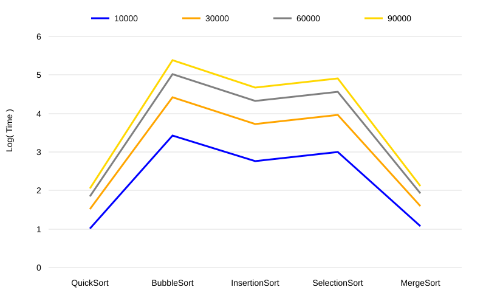

# Algoritmos de ordenação em C: comparação de tempo médio

Trabalho de Algoritmos e Estruturas de Dados (UFTM).
Aluno: João Maerbal Nunes Barros.

O programa implementa cinco algoritmos de ordenação do zero, sem nenhuma biblioteca de ordenação, e compara o tempo médio de cada um em vetores de números aleatórios de **10.000, 30.000, 60.000 e 90.000** elementos. Cada tamanho é medido em **5 execuções**; o programa calcula a média, o log da média e gera um gráfico SVG.

Vídeo de apresentação: https://www.youtube.com/watch?v=3vfH9RDy3Oo

## Algoritmos

| Algoritmo | Complexidade (caso médio) | Observação |
|---|---|---|
| QuickSort | O(n log n) | pivô no elemento do meio |
| MergeSort | O(n log n) | usa vetor auxiliar alocado uma vez por ordenação |
| InsertionSort | O(n²) | desloca em vez de trocar |
| SelectionSort | O(n²) | no máximo uma troca por passada |
| BubbleSort | O(n²) | para cedo se uma passada não fizer trocas |

## Como compilar e rodar

```bash
gcc ordenacao.c -o ordenacao -lm
./ordenacao
```

O `-lm` é só para o `log10`. A execução completa leva alguns minutos, principalmente por causa do BubbleSort com 90.000 elementos.

Ao terminar, o programa grava:

- `resultados.csv`: os tempos das 5 execuções, a média e o log da média (separador `;`);
- `grafico.svg`: log do tempo médio por algoritmo, uma linha para cada tamanho.

## Metodologia

- Em cada execução, um vetor aleatório é gerado para cada tamanho, e **os cinco algoritmos ordenam cópias do mesmo vetor**.
- O tempo é medido com `clock()` e registrado em unidades de **0,1 ms**, como no modelo da disciplina.
- Depois de cada ordenação, o programa confere se o vetor ficou em ordem crescente.

## Resultados

Médias das 5 execuções (convertidas para milissegundos) do `resultados.csv` deste repositório:

| Algoritmo | n = 10.000 | n = 30.000 | n = 60.000 | n = 90.000 |
|---|---:|---:|---:|---:|
| QuickSort | 1,03 ms | 3,24 ms | 7,13 ms | 11,34 ms |
| MergeSort | 1,20 ms | 3,88 ms | 8,54 ms | 13,06 ms |
| InsertionSort | 57,9 ms | 526 ms | 2.087 ms | 4.632 ms |
| SelectionSort | 102 ms | 929 ms | 3.629 ms | 8.084 ms |
| BubbleSort | 264 ms | 2.597 ms | 10.545 ms | 23.853 ms |



- A diferença entre O(n log n) e O(n²) cresce com n: com 10.000 elementos o InsertionSort leva cerca de 50 vezes o tempo do MergeSort; com 90.000, o BubbleSort leva cerca de 2.100 vezes o tempo do QuickSort.
- Entre os O(n²), o InsertionSort é o mais rápido e o BubbleSort o mais lento: o Bubble faz uma troca (três atribuições) para cada par fora de ordem, enquanto o Insertion só desloca.
- Triplicar n de 30.000 para 90.000 multiplica o tempo dos O(n²) por cerca de 9, como esperado para crescimento quadrático.

Os tempos absolutos dependem da máquina; os números acima vêm de uma rodada completa do programa (5 execuções) num único computador.

## Estrutura

| Arquivo | Conteúdo |
|---|---|
| `ordenacao.c` | os algoritmos, a medição e a geração do CSV e do gráfico |
| `resultados.csv` | tempos medidos (unidade de 0,1 ms) |
| `grafico.svg` | gráfico gerado pelo programa |
